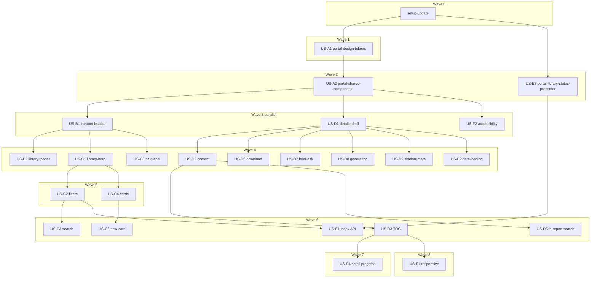

# Reports Portal — Branching & Worktree Process

This document defines how to branch, isolate, merge, and test each user story (US) so every story builds on a **verified parent** and can be exercised in a running app.

## Principles

1. **Main checkout stays on `setup-update`** — no portal feature commits in the repo root.
2. **One worktree per change** — `.worktrees/<change-name>/` on `feature/<change-name>`.
3. **Branch from the dependency tip** — never from `setup-update` if the US depends on prior portal work (except US-A1 and US-E3).
4. **Parent must be verify-complete** — OpenSpec verify passes on the dependency branch before creating the child worktree.
5. **Integration branch for end-to-end QA** — optional `feature/reports-portal` receives merges in wave order for full library + reader flows.

## Branch naming

| Item | Pattern |
|------|---------|
| Feature branch | `feature/<change-name>` (same as OpenSpec change name) |
| Worktree path | `.worktrees/<change-name>/` |
| Integration (optional) | `feature/reports-portal` |

## Create a worktree (standard command)

Run from repository root (`setup-update` checked out):

```bash
SOURCE_ROOT=$(git rev-parse --show-toplevel)
PARENT_BRANCH="feature/<parent-change-name>"   # omit for setup-update parents
CHANGE_NAME="portal-<story-slug>"
BRANCH="feature/${CHANGE_NAME}"

mkdir -p "$SOURCE_ROOT/.worktrees"
git worktree add "$SOURCE_ROOT/.worktrees/$CHANGE_NAME" -b "$BRANCH" "$PARENT_BRANCH"
cd "$SOURCE_ROOT/.worktrees/$CHANGE_NAME"

# Copy local Claude settings if needed (see using-git-worktrees skill)
```

**Parent branch reference**

| US | Change name | Branch from (`PARENT_BRANCH`) |
|----|-------------|-------------------------------|
| US-A1 | `portal-design-tokens` | `setup-update` |
| US-A2 | `portal-shared-components` | `feature/portal-design-tokens` |
| US-E3 | `portal-library-status-presenter` | `setup-update` *(no token dep; merge into library lane before E1)* |
| US-B1 | `portal-intranet-header` | `feature/portal-shared-components` |
| US-B2 | `portal-library-topbar-actions` | `feature/portal-intranet-header` |
| US-C1 | `portal-library-hero` | `feature/portal-intranet-header` |
| US-C6 | `portal-nav-reports-analysis-label` | `feature/portal-intranet-header` |
| US-C2 | `portal-library-filters` | `feature/portal-library-hero` |
| US-C4 | `portal-library-cards` | `feature/portal-library-hero` |
| US-C3 | `portal-library-search` | `feature/portal-library-filters` |
| US-C5 | `portal-new-report-card` | `feature/portal-library-cards` |
| US-E1 | `portal-index-search-filter-api` | `feature/portal-library-filters` + **merge** `feature/portal-library-status-presenter` before verify |
| US-D1 | `portal-details-shell` | `feature/portal-shared-components` |
| US-D2 | `portal-details-content` | `feature/portal-details-shell` |
| US-E2 | `portal-details-data-loading` | `feature/portal-details-shell` |
| US-D6 | `portal-details-download-menu` | `feature/portal-details-shell` |
| US-D7 | `portal-details-brief-ask-placeholders` | `feature/portal-details-shell` |
| US-D8 | `portal-details-generating-state` | `feature/portal-details-shell` |
| US-D9 | `portal-details-sidebar-metadata` | `feature/portal-details-shell` |
| US-D3 | `portal-details-toc-scroll` | `feature/portal-details-content` |
| US-D5 | `portal-details-in-report-search` | `feature/portal-details-content` |
| US-D4 | `portal-details-scroll-progress` | `feature/portal-details-toc-scroll` |
| US-F2 | `portal-accessibility` | `feature/portal-shared-components` *(can run with B1/D1 wave; merge before release)* |
| US-F1 | `portal-responsive-layout` | `feature/portal-details-toc-scroll` |

## Delivery waves (dependency-respecting)



### Wave summary (execution order)

| Wave | Stories | Max parallel worktrees |
|------|---------|----------------------|
| 1 | A1 | 1 |
| 2 | A2, E3 | 2 |
| 3 | B1, D1, F2 | 3 |
| 4 | B2, C1, C6, D2, D6, D7, D8, D9, E2 | up to 9 *(practical: 2–3 at a time)* |
| 5 | C2, C4 | 2 |
| 6 | C3, C5, E1, D3, D5 | 5 |
| 7 | D4 | 1 |
| 8 | F1 | 1 |

**Library lane (sequential minimum):** A1 → A2 → B1 → C1 → C2 → C3 → E1 (with E3 merged before E1).

**Reader lane (sequential minimum):** A1 → A2 → D1 → D2 → D3 → D4 → F1 (D5/D6/D7/D8/D9/E2 branch off D1/D2 as above).

## Per-US: merge gate + how to test

Before marking a US **done**, complete in its worktree:

1. OpenSpec: `new` → `ff` → `apply` → `verify`
2. Mandatory steps in `tasks.md` (tests, reports)
3. **Smoke test** below (manual or system test)

| US | Merge into child branches when | Smoke test (minimum) |
|----|-------------------------------|----------------------|
| **A1** | A2, (optional E3) | `bin/rails tailwindcss:build`; page with `render "shared/portal_theme_wrapper"` shows cream bg + Newsreader |
| **A2** | B1, D1, F2 | Render topbar + avatar + filter pill partials in a stub intranet view |
| **E3** | Before E1 verify | `bin/rails test test/presenters/report_library_presenter_test.rb` |
| **B1** | B2, C1, C6 | Load `/intranet/reports` — portal navbar, initials menu, no "Hi, name" |
| **B2** | — | Library topbar shows **New report** only (no settings gear) |
| **C1** | C2, C4 | Library title **Reports**, stats row, no subtitle |
| **C2** | C3 | Filter pills + counts; `?filter=complete` works |
| **C3** | — | `?q=` search returns filtered cards |
| **C4** | C5 | Cards hover/animation; complete → `/details`; in-progress → generating |
| **C5** | — | First grid cell links to `new_intranet_report` |
| **C6** | — | Nav label **Reports analysis** |
| **E1** | — | Index respects `q` + `filter`; controller tests green |
| **D1** | D2, D6–D9, E2 | `GET /intranet/reports/:id/details` — shell + back link |
| **E2** | — | Details loads without N+1; 404 for other user |
| **D2** | D3, D5 | Full report sections in DOM (complete report) |
| **D3** | D4 | TOC highlights on scroll; click scrolls to section |
| **D4** | F1 | Top progress bar tracks scroll |
| **D5** | — | `/` focuses search; highlights + result panel |
| **D6** | — | Download dropdown → PDF + DOCX download |
| **D7** | — | Brief/Ask visible, disabled; no Highlights |
| **D8** | — | In-progress report shows generating UI + pipeline link |
| **D9** | — | Sidebar REPORT metadata block |
| **F2** | Release | Keyboard: avatar menu, TOC `aria-current`, disabled controls |
| **F1** | Release | Reader sidebar toggle; library grid at 375px |

## Integration branch workflow (recommended for QA)

Use one long-lived branch to assemble verified stories for full flows:

```bash
# Once, from setup-update:
git branch feature/reports-portal setup-update

# After each US verify passes:
cd .worktrees/<change-name>
git checkout feature/<change-name>
git pull --ff-only   # if using remote later

cd $SOURCE_ROOT
git checkout feature/reports-portal
git merge --no-ff feature/<change-name> -m "merge: <change-name> (<US-ID>)"

# Smoke test integration on feature/reports-portal worktree (optional second worktree)
```

**Merge order into `feature/reports-portal`** (same as waves):

`A1 → A2 → E3 → B1 → (B2,C1,C6) → (C2,C4) → C3 → C5 → E1 → D1 → (D2,D6,D7,D8,D9,E2) → (D3,D5) → D4 → F2 → F1`

## Development database backup (before any dev mutation)

When manual QA or apply steps need `db:seed`, `db:reset`, or other **development** writes:

1. Agent root must be the **worktree** (`.worktrees/<change-name>/`).
2. Run **`backup-development-database`** skill:
   ```bash
   ./ai-specs/scripts/backup_development_database.sh
   ```
3. Dumps go to **`tmp/db-backups/`** in that worktree (not repo root on `setup-update`).
4. Record the path in `openspec/changes/<change>/reports/YYYY-MM-DD-development-db-backup.md`.
5. Do **not** run `db:seed` until backup succeeds.

Test-only work (`RAILS_ENV=test`, `bin/rails test`) does not require this step.

## Starting the next US (checklist)

- [ ] Parent US verify-complete on `feature/<parent>`
- [ ] Main repo on `setup-update`
- [ ] `git worktree add .worktrees/<change> -b feature/<change> feature/<parent>`
- [ ] Open Cursor/agent root at `.worktrees/<change>/`
- [ ] **Backup development DB** if this US will seed or mutate development data (see above)
- [ ] Run pipeline: enrich-us (already in `parallel-tasks.md`) → `openspec new` → `ff` → `apply` → `verify`
- [ ] Smoke test from table above
- [ ] Optional: merge into `feature/reports-portal`

## Current state (2026-05-21)

| Branch | Worktree | Status |
|--------|----------|--------|
| `feature/portal-design-tokens` | `.worktrees/portal-design-tokens/` | US-A1 implemented (verify/archive pending); **parent for A2** |
| `setup-update` | repo root | Clean integration point |

**Next story:** US-A2 — branch from `feature/portal-design-tokens` after A1 verify passes.
